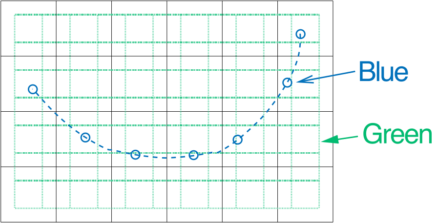

Interpolation in ARTS
#####################

ARTS interpolates with Lagrange polynomials, of any order and in as many
dimensions as the data have.  Everything is in the file

- ``matpack/lagrange_interp.h``

and its tests are in ``src/core/tests/test_laginterp.cpp``.  An interpolation
takes two steps:

1. ``make_lags`` (one call for each interpolation dimension) finds, for every
   new grid point, the original grid points it is interpolated from and their
   weights.
2. ``interp``, ``reinterp`` or ``flat_interp`` combines the data with these
   weights.

``make_lags<O, transform>(old_grid, new_grid, extrapolation_limit, info)``
gives a list of ``lag_t<O, transform>``, one per point of ``new_grid``.  It
throws if a new point lies further outside ``old_grid`` than
``extrapolation_limit`` (0.5 by default) times the spacing of the last two
points at that end of ``old_grid``; a limit of 0 or less checks nothing, and
the weights then extrapolate the polynomial without limit.  The polynomial
order may also be given at runtime, ``make_lags<transform>(old_grid,
new_grid, order, ...)``, and ``variant_lag`` picks the highest order up to a
maximum that a short grid supports.

The interpolated values need not be numbers: any type with a zero default,
``+=`` and a product with a :class:`~pyarts3.arts.Numeric` works, such as the
rtepack types.  A value of such a compound type is multiplied once per term,
by the product of the term's weights.

Green and blue interpolation
============================

  The two different types of interpolation. Green (dotted):
  Interpolation to a new grid, output has same dimension as input,
  in this case 2D. Blue (dashed): Interpolation to a sequence of
  points, output is always 1D.

There are two different types of interpolation in ARTS:

- *Green Interpolation*: Interpolation of a gridded field to a new grid,
  ``reinterp``.
- *Blue Interpolation*: Interpolation of a gridded field to a sequence of
  positions, ``flat_interp``.

The figure above illustrates the different types for a 2D example.
``interp`` interpolates a field to one position.

Lags
====

The framework uses a template class,
``lagrange_interp::lag_t<>``, which is described below.
The class takes two compile-time parameters, the polynomial order
:math:`O` and  grid transformation type.  The rules for how
to transform the grid are in the file ``matpack/lagrange_interp.h``.
Regardless, the template type holds weights and indices to the
original grid, which are used to compute the interpolated value
and which are used to map into the data field.

Three styles of interpolations are implemented as functions:

- ``interp``: Pure interpolation.  Reduces the data field to the
  a single interpolated value.  Takes as many ``lagrange_interp::lag_t<>``
  as the rank of the data field.  May also use precomputed
  ``interpweights``, but this is not required.
  The signature is either ``T interp(data, lag_t<>, lag_t<>, ...)``
  or ``T interp(data, interpweights, lag_t<>, lag_t<>, ...)``, to
  return the interpolated value ``T``.
- ``reinterp``: Reinterpolates the data to a new grid.  Retains
  the same rank as the data field but changes the grid.  This
  takes as many lists of ``lagrange_interp::lag_t<>`` as the
  rank of the data field.  The lists can be of any type that
  follows rules similar to ``std::vector`` or ``std::array``.
  May use precomputed multidimensional ``reinterpweights``,
  and it may reuse data.  This yields four possible signatures:
  ``void reinterp(data_t&, data, list<lag_t<>>, list<lag_t<>>, ...)``,
  ``void reinterp(data_t&, data, reinterpweights, list<lag_t<>>, list<lag_t<>>, ...)``,
  ``data_t reinterp(data, list<lag_t<>>, list<lag_t<>>, ...)``, and
  ``data_t reinterp(data, reinterpweights, list<lag_t<>>, list<lag_t<>>, ...)``.
- ``flat_interp``: Interpolates a line through the data field composed
  of all the coordinates of the ``lag_t<>`` objects.  This reduces
  the data_field to a vector of values.  For rank 1 data fields,
  this is equivalent to the ``interp`` function.  The methods take
  as many lists of ``lag_t<>`` as the rank of the data field.  These
  must all have the same length, and this length is the size of the
  output vector.  May use precomputed multidimensional
  ``flat_interpweights``, and it may reuse data.  This yields four possible
  signatures:
  ``void flat_interp(data_t&, data, list<lag_t<>>, list<lag_t<>>, ...)``,
  ``void flat_interp(data_t&, data, flat_interpweights, list<lag_t<>>, list<lag_t<>>, ...)``,
  ``data_t flat_interp(data, list<lag_t<>>, list<lag_t<>>, ...)``, and
  ``data_t flat_interp(data, flat_interpweights, list<lag_t<>>, list<lag_t<>>, ...)``.

Weights
-------

Lagrange weights are computed as:

.. math::

  l_j(x) = \prod_{\substack{0 \leq m \leq O \\ m \neq j}}
  \frac{u(f(x)) - u(f(x _m))}{u(f(x_j)) - u(f(x_m))}

where :math:`f` is a grid scaling function and :math:`u` deals with cyclicity.
The transformation can be whatever, but most common
is to use the identity function :math:`f(x) = x`, which is thus the default.

Grid cyclicity
--------------

If the grid is cyclic :math:`\left[X_0, X_1\right)`,
and for simplicity of writing these examples :math:`f(x) = x`, then
the algorithmic first thing that happens is that :math:`x` is shifted
to be within this range :math:`\left[X_0, X_1\right)`.
If the grid coordinates closest to :math:`x` after the shift are
:math:`\left[x_j, x_{j+1}, \cdots, x_{j+n}\right]`,
and :math:`x_j \leq x \lt x_{j+n}` then :math:`u(x) = x` for all values.
If :math:`x \lt x_j`, then :math:`u(x) = x + X_0 - X_1`
for all :math:`x_i \geq \left(X_1-X_0\right) / 2`.
If :math:`x \gt x_{j+n}`, then :math:`u(x) = x - X_0 + X_1`
for all :math:`x_i \lt \left(X_1-X_0\right) / 2`.

Examples
========

A simple example
----------------

Linear interpolation of a vector to a new grid:

.. code-block:: C++

  const Vector og{1, 2, 3, 4, 5};
  const Vector ng{2.0, 2.25, 2.5, 2.75, 3.0};

  // One lag per new grid point: the two original grid points and their weights
  const auto lags = lagrange_interp::make_lags<1, lagrange_interp::grid_identity>(og, ng);

  const Vector of{0, 0, 10, 0, 0};
  const Vector nf = lagrange_interp::reinterp(of, lags);  // 0 2.5 5 7.5 10

A more elaborate example
------------------------

To interpolate only some dimensions of a tensor, loop over the others.  Here
every page of a Tensor3 is interpolated to new row and column grids (green
interpolation), reusing the same weights for every page:

.. code-block:: C++

  const Vector a_grid{1, 2, 3};
  Tensor3      a(3, 3, 3, 0.0);
  a[0, 1, 1] = 10;
  a[1, 1, 1] = 20;
  a[2, 1, 1] = 30;

  const Vector n_grid{1, 1.5, 2, 2.5, 3};
  const auto   rlags = lagrange_interp::make_lags<1, lagrange_interp::grid_identity>(a_grid, n_grid);
  const auto   clags = lagrange_interp::make_lags<1, lagrange_interp::grid_identity>(a_grid, n_grid);
  const auto   itw   = lagrange_interp::reinterpweights(rlags, clags);

  Tensor3 n(a.npages(), n_grid.size(), n_grid.size());
  for (Index i = 0; i < a.npages(); ++i)
    lagrange_interp::reinterp(n[i, joker, joker], a[i, joker, joker], itw, rlags, clags);

The pages of the result are:

.. code-block:: C++

  page 0:
  0 0   0  0   0
  0 2.5 5  2.5 0
  0 5   10 5   0
  0 2.5 5  2.5 0
  0 0   0  0   0
  page 1:
  0 0  0  0  0
  0 5  10 5  0
  0 10 20 10 0
  0 5  10 5  0
  0 0  0  0  0
  page 2:
  0 0   0  0   0
  0 7.5 15 7.5 0
  0 15  30 15  0
  0 7.5 15 7.5 0
  0 0   0  0   0
